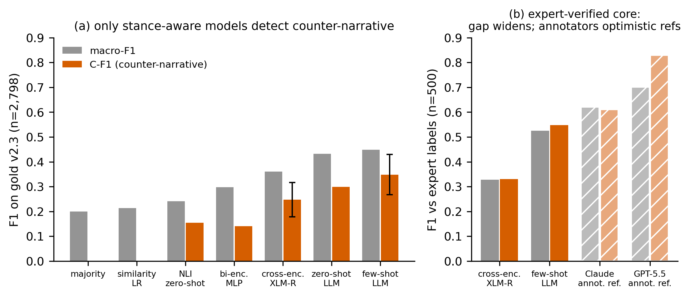
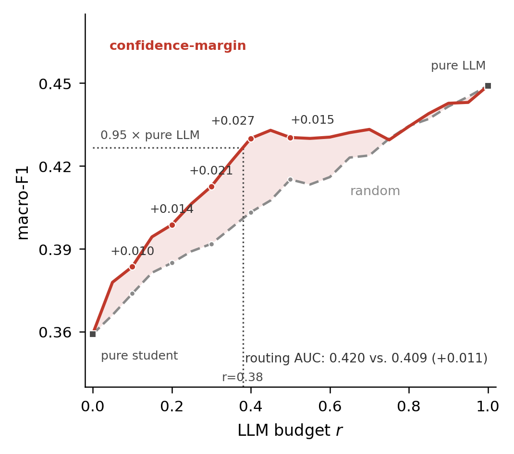
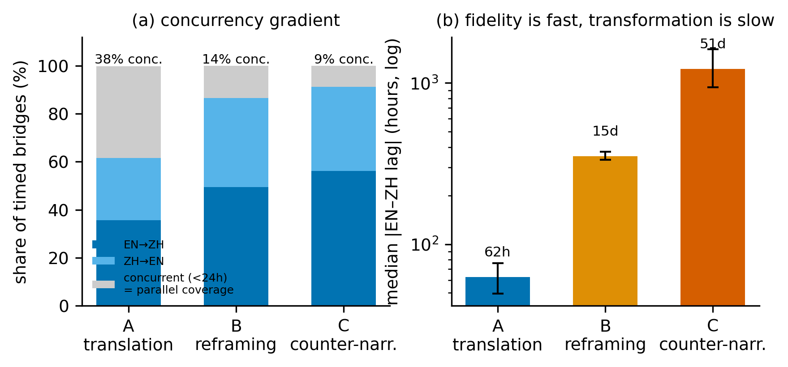

# FUSE-C / FUSE-C+: Cross-Lingual Bridge Detection


Code, codebook, and frozen result artifacts for the paper *"FUSE-C: Multi-View Fusion and
Selective Cascading for Cross-Lingual Bridge Detection."*

**Task.** Given an English post and a Chinese post about the same event, decide whether the Chinese
post carries the same specific claim across the language boundary, and if so *how*:
**A** = translation / faithful restatement, **B** = reframing, **C** = counter-narrative,
**no** = no bridge.

| dir | contents |
|---|---|
| `docs/` | annotation codebook (`ANNOTATION_GUIDELINES.md`), refined adjudication rules (`ADJUDICATION.md`), tiered data-release policy (`DATA_RELEASE.md`), `references.bib` |
| `collection/` | per-platform collection tooling (Reddit/Arctic Shift, X, YouTube, HN, Bluesky, Weibo, Bilibili) with per-event windows and query terms in `events_clean.yaml` and in-script event lists; Zhihu/Douyin were crawled with the open-source MediaCrawler tool using the same per-event keywords. A Telegram collector from early collection is included; Telegram posts did not enter the final benchmark. Release Tier 3 |
| `pipeline/` | candidate generation (BGE-M3), LLM annotation, agreement/κ, gold construction |
| `eval/` | all benchmark systems: baselines, NLI transfer, cross-encoder (XLM-R), zero/few-shot LLM, CIs |
| `fusec_plus/` | the pre-registered FUSE-C+ arbiter: pre-registration, Stage-0/1 rebuild + 3-seed student ensemble, assistant-signal collection, validation harness, descriptive-CI script, frozen per-pair signal files |
| `analysis/` | bridge anatomy (direction, latency, platform pathways, event signatures) + figure generation |
| `expert_audit/` | blind-audit protocol, scorer, and summary statistics (five batches, 1,445 pairs) |
| `results/` | frozen result JSONs backing every number in the paper |
| `figures/` | paper figures (PDF/PNG) |

## Data access (three tiers — see `docs/DATA_RELEASE.md`)

Post **text** is not in this repository. Per-platform terms:
- **Tier 1 (public, separate dataset release):** all pair annotations, labels, adjudications,
  audit artifacts, IDs/URIs + timestamps; full text only where terms permit (Hacker News);
  ≤50-char gold excerpts for Chinese platforms.
- **Tier 2 (gated):** full gold text under a research data-use agreement (non-commercial,
  no redistribution, no user profiling) — motivated by censorship-correlated rehydration decay.
- **Tier 3 (this repo):** complete re-collection configurations.

Scripts expect the data files (`llm_labels_*.jsonl`, `gold_consensus.jsonl`,
`gold_v3_extended.jsonl`, embeddings) in their working directory; obtain them via Tier 1/2 and
place them alongside, or re-collect via `collection/`.

## Reproducing the paper's numbers

```bash
pip install -r requirements.txt          # torch env needed for cross-encoder / NLI
# benchmark gold v2.3 (n=2,798, event-disjoint)
python eval/gold_baselines.py            # majority / sim-LR / bi-encoder / zero-shot LLM
python eval/nli_baseline.py              # NLI zero-shot + NLI-LR
python eval/phase4b_bench.py             # cross-encoder (XLM-R on GPT-5.5 silver)
python eval/fewshot_eval.py --model gpt-5.1-sol
python eval/fuse_c_v.py --root eval --out results
# extended gold v3 (n=6,451, LLM systems only — see paper §6 for why)
python eval/fewshot_v3_run.py            # checkpointed / resumable
# audit scoring + figures
python expert_audit/expert_audit_score.py
python analysis/make_figures.py
# FUSE-C+ arbiter (pre-registered; frozen signals included -- no API key needed)
python fusec_plus/fusecplus_validate_v2.py     # Table II arbiter/self-consistency rows + paired tests
python fusec_plus/arbiter_standalone_cis.py    # descriptive CIs (verifies frozen-prediction reproduction first)
```



`eval/fuse_c_v.py` is the same-budget verifier prototype: it combines one few-shot LLM prediction
per pair with local FUSE-C predictions and trains an event-disjoint verifier. It expects per-pair
artifacts rather than summary JSONs: `gold_consensus.jsonl`, `fewshot_llm_preds.json`, and
`local_fuse_c_preds.json` under the `--root` directory. If these files are absent, the script reports
the missing paths and exits without fabricating results.

Key frozen numbers (see `results/` and `expert_audit/audit_results_summary.json`):
few-shot LLM C-F1 **0.35** [.27,.43] on benchmark gold / **0.33** [.28,.39] on extended gold /
**0.55** on the expert-verified core; cross-encoder 0.25 / — / 0.33; all stance-blind baselines ≤0.17.
FUSE-C+ arbiter (pre-registered): C-F1 **0.391** on benchmark gold (vs LLM 0.348, p=0.055 --- reported
as edge-of-significance, not a win) / **0.609** on the expert core (macro gain significant, p=0.025).

## Key results at a glance



Confidence-margin routing dominates random routing over the whole budget sweep, and the cascade
reaches 95% of the pure-LLM macro-F1 at 38% of its call budget. Regenerate with
`python analysis/gen_cascade_sweep.py`; every plotted number is asserted against
`results/pareto_fine_v23.json` before drawing.



Fidelity crosses the language boundary fast, transformation is slow: the median |EN–ZH| lag rises
from 62 hours (translation) to 15 days (reframing) and 51 days (counter-narrative), and the
concurrent share falls from 38% to 9% (silver labels, descriptive; `results/bridge_science_result.json`).

| Directory | Role |
|---|---|
| `collection/` | Historical collection tools |
| `pipeline/` | Candidate preparation, annotation and features |
| `eval/` | Earlier baselines, transfer evaluation and verifier prototype |
| `analysis/` | Temporal/direction analysis and plotting |
| `tests/` | Earlier modular-code tests |
| `expert_audit/` | Earlier audit scorer and private artifacts |
| `docs/`, `results/`, `figures/` | Historical records, not automatically released |

## License & citation

Code is released under the MIT License (see `LICENSE`). Pair annotations are released under
CC BY 4.0 with the Tier 1 dataset; platform content is governed by `docs/DATA_RELEASE.md`.
Citation entry will be added on acceptance.

No license has been selected by this preparation step. Corpus release and platform-content permissions are separate decisions.